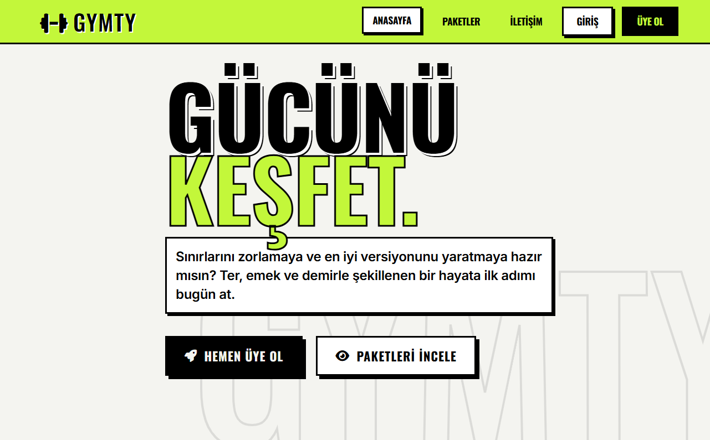
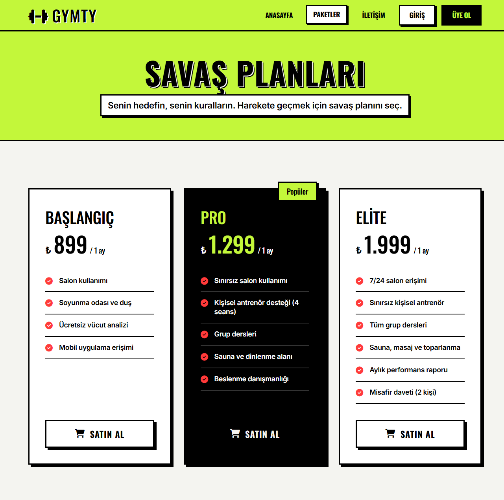

# GYMTY Fitness

GYMTY Fitness, modern spor salonlarının üyelik süreçlerini dijitalleştirmek amacıyla geliştirilmiş, karanlık tema ve neon vurgularla tasarlanan bir fitness üyelik yönetim uygulamasıdır.

Okul döneminde dönem projesi olarak geliştirdiğim bu projeyi, daha sonra arayüz tasarımını ve uygulama yapısını sergilemek amacıyla GitHub'da paylaşmaya karar verdim.

PHP ve MySQL ile geliştirilen proje; üyelik kaydı, paket seçimi, ödeme adımı, üye paneli ve yönetici paneli gibi temel işlevleri tek bir uygulamada bir araya getirir.

[](https://www.php.net/)
[](https://www.mysql.com/)
[](LICENSE)

## Ekran Görüntüleri





## Tasarım

- Beş neon renk teması (yeşil, pembe, mavi, sarı, mor); seçim çerezde saklanır
- Oswald başlık + Inter gövde tipografisi
- Sert gölgeli, kalın çerçeveli kartlar ve hover'da kayma efekti
- Mobil açılır menü, scroll ile görünen sayaçlar ve bölüm geçişleri
- Font Awesome 6 ikonları, tamamen responsive ızgara yapısı

## Teknolojiler

PHP 8 (PDO), MySQL, JavaScript, CSS, HTML

## Klasör yapısı

```
admin/             Yönetici paneli ve AJAX uç noktası
assets/            CSS, JS, favicon
config/            .env okuyucu ve veritabanı bağlantısı
database/          Tablo şeması ve örnek veriler
docs/screenshots/  README'de kullanılan ekran görüntüleri
includes/          Ortak header/footer, oturum ve doğrulama yardımcıları
storage/           Hız sınırlayıcı sayaçları
```

## Notlar

- Ödeme adımı demodur; kart bilgileri sunucuya gönderilmez, üyelik ödeme doğrulaması
  yapılmadan aktifleşir. Gerçek kullanım için bir ödeme sağlayıcısı entegre edilmelidir.
- T.C. Kimlik Numarası demo amacıyla düz metin saklanır.
- Formlar CSRF korumalıdır, şifreler `password_hash` ile saklanır, tüm sorgular
  prepared statement kullanır.

## Lisans

[MIT](LICENSE)
